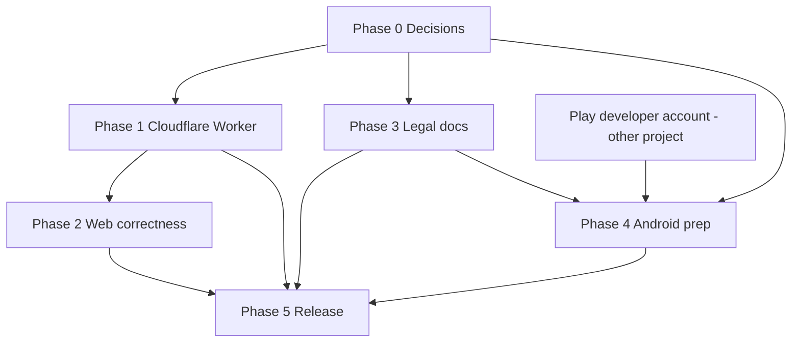

# XegQR - v1.0.0 Release Roadmap

> **Purpose:** What has to be true, and in what order, to release XegQR alongside NetXegManager and PoGoAccountManager. Written for this app specifically: no login, no backend, no database, no email, no Firebase. That removes most of what the sibling roadmaps spend their time on.

**Written:** 2026-10-09 | **Baseline:** `extra.appVersion` 0.1.6, `expo.version` 0.1.0 (now 0.2.8 and 0.2.2 as of 2026-10-30), Android package `com.xegster.xegqr`

## Targets

| Surface | Where | Notes |
|---|---|---|
| Web app | `https://qr.xegster.com.au` | Cloudflare Workers static assets (same as PoGoAccountManager), static export from `expo export -p web` |
| Legal | `https://qr.xegster.com.au/privacy`, `/terms`, `/support` | **Per-app, decided 2026-10-20** (matches the other two apps; see `PoGoAccountManager/.cursor-plans/shared-publishing-decisions.md`). Static files in `public/`, served by the same Worker as the app. Phase 3. Supersedes the earlier idea of a shared `xegster.com.au/ToS` |
| Android | Google Play | Package `com.xegster.xegqr` already set |
| iOS | Not planned | **Decided:** no iOS for any app until after the Android release, possibly never. `bundleIdentifier` and the encryption flag are already set, so nothing blocks it if that changes |

## What makes this release different from the other two

- **No accounts, no server data.** Nothing a user types leaves the device. There is no account deletion flow, no Firestore rules, no billing tier, no verification email and no SendGrid/DNS mail records. None of that appears below.
- **Web is the primary product, not an afterthought.** The site is a real deliverable (and the cheapest way to get users), so it gets a proper hosting move and security headers rather than "deploy the export somewhere".
- **The privacy story is the selling point and the main legal surface.** It must be accurate about the camera, the photo library, and local storage, because those are the only things the app touches.
- **Some code types carry financial or credential content** (Wi-Fi passwords, authenticator secrets, crypto, SEPA bank transfer, PayPal). That matters for the ToS wording and the Play Console declarations.
- **The legal pages are this app's own.** They live in this repo and ship with the Worker, so there is no cross-project dependency. The operator name, support email and governing law are the only values shared with the other two apps.

## Current state (verified in the repo)

| Area | State |
|---|---|
| Web hosting | **Cloudflare Workers config is in the repo (2026-10-19, `b9d90ae`):** `wrangler.jsonc`, `npm run deploy:web`, `public/_headers`, `robots.txt`, web metadata. **Not confirmed deployed**: the Worker, GitHub connection and custom domain are yours to do (Phase 1). `.github/workflows/eas-hosting-deploy.yml` is still present and still deploys to EAS Hosting until 1.7 |
| Android OTA | `eas-update.yml` publishes to the `preview` channel on every `develop` push (commit message now passed via an env var, 2026-10-20/22, so quotes in messages no longer break it). No production-channel workflow yet |
| Android build | `eas.json` has `development`, `preview` (APK), `production` (AAB). Production has no `autoIncrement` and `app.config.js` has `versionCode: 1` with `appVersionSource: remote` |
| Play submit | `eas.json` points at `./google-service-account.json`. No Play Console app exists yet (assumed) |
| Web storage | IndexedDB via `src/db/store.web.js`; SQLite on native |
| Web scanning | `app/scan.js` already shows a "not available in this browser" panel for browsers without barcode support |
| Legal links in app | **Done 2026-10-20:** Settings has a Legal panel (Privacy Policy, Terms of Use, Support) via `src/utils/legalLinks.js`. Pages are drafts with placeholders (Phase 3) |
| Docs | README describes EAS Hosting and says "Matches the NetXegManager and PoGoManager projects" |

---

## Priority task: staging and production on one Worker (HIGH, do before the other open 1.0 work)

**Added 2026-10-16.** Same setup as Xegster (`C:\Development\Xegster`: `SETUP.md` section 2). One fixed staging address and one production address; no second Worker.

- **One Worker, two branches.** The production branch builds and deploys the Worker as it does today. The `develop` branch is staging: on the Worker, Settings, Build, Previews, turn **Builds for preview branches** on and keep the default preview command. A push to `develop` then builds a preview with a stable branch address on `workers.dev`; confirm the exact URL from the first build.
- **No code change needed.** Do not add a second Worker or `env.staging` to `wrangler.jsonc`.
- **Flow:** work on `develop`, check the preview, merge into the production branch to release.
- **Open checks:** any other branch you push also gets a preview URL (no branch filter found); the preview shares the production backend, so decide whether staging needs its own data; previews should not be indexed by search engines. XegQR is still on EAS Hosting (see "Current state"), so do this as part of the move to Cloudflare Workers; `qr.xegster.com.au` is the production address.
- **Docs to update when done:** this roadmap, `Publish.md` / `SETUP.md` (Cloudflare section), the `README.md` deploy note.
---

## Phase 0 - Decisions and prerequisites (no code)

| # | Item | Status |
|---|---|---|
| 0.1 | Confirm `xegster.com.au` is an active zone in the Cloudflare account (PoGo's roadmap planned this as E-1; unknown whether it is done) | Open |
| 0.2 | Legal pages are per-app (Phase 3): each app hosts its own `/privacy`, `/terms`, `/support`. A shared site was rejected because the apps' data practices differ and the Play privacy URL and Data safety form must match one app | **Decided 2026-10-20** (replaces "shared phase") |
| 0.3 | Exact page set and URLs: `https://qr.xegster.com.au/privacy`, `/terms`, `/support` | **Decided 2026-10-20** |
| 0.4 | Deploys: pushing to the repo must keep building and deploying the web app. Mechanism is an implementation detail | **Decided** |
| 0.5 | iOS | **Decided:** out until after the Android release, maybe never |
| 0.6 | Play developer account | **Not created yet**; coming up in another project. XegQR reuses it (Phase 4) |
| 0.7 | Analytics: recommendation **none**. If Cloudflare Web Analytics is ever turned on, the privacy policy must say so | Open |

---

## Phase 1 - Move web hosting to Cloudflare Workers

Goal: `qr.xegster.com.au` serves the app; EAS Hosting is retired.

| # | Item | Notes |
|---|---|---|
| 1.1 | Create the Worker `xegqr` (`wrangler.jsonc` is in the repo, **done 2026-10-19**). First deploy by hand with `npm run deploy:web` (needs `npx wrangler login`), then connect it to the GitHub repo | Git build: build command `npx expo export -p web`, deploy command `npx wrangler deploy`, env `NODE_VERSION=22`. Production branch `main`; `develop` is staging via the priority task above |
| 1.2 | First deploy lands on the `xegqr` `workers.dev` address and works | Check by hand: create, style, save, reload (IndexedDB persists), export PNG/SVG |
| 1.3 | Add custom domain `qr.xegster.com.au` to the Worker (Settings, Domains & Routes) | Cloudflare creates the DNS record since the zone is already there (needs 0.1). Wait for the certificate to go Active. **Done 2026-10-28:** `qr.xegster.com.au` is attached to `xegqr`, and so is `www.qr.xegster.com.au` (same custom-domain setup as `www.pogo` and `www.tmtracker`). The zone's "Redirect from WWW to root" rule 301s `www.qr` to `qr`, path included; verified with curl |
| 1.4 | SPA fallback | `web.output` is `single`, so the export is one `index.html`. `wrangler.jsonc` sets `not_found_handling: single-page-application`, so unknown paths get `index.html`. Verify deep links work on hard refresh: `/saved`, `/settings`, `/generate/wifi` |
| 1.5 | Add `public/_headers` (**done 2026-10-19**, file is in the repo; verify the headers after the first deploy) | Expo copies `public/` into `dist/`. Contents: `Permissions-Policy: camera=(self)` (the scan screen needs the camera, nothing else needs anything), `X-Content-Type-Options: nosniff`, `Referrer-Policy: strict-origin-when-cross-origin`, `X-Frame-Options: DENY`, and long immutable caching for the hashed `/_expo/static/*` assets. Do **not** set a strict CSP blindly: the SVG export path in `src/services/qrExport.js` and `react-native-svg` use inline styles and blob/data URLs, and a wrong CSP breaks export silently. Add one only after testing |
| 1.6 | `public/robots.txt` (**done 2026-10-19**) and web metadata in `app.config.js` (`web.name`, `shortName`, `description`, `themeColor`, `backgroundColor` **done 2026-10-19**); still open: social preview tags and optional PWA manifest. Original note: `public/robots.txt`, plus `<title>`, description, and social preview tags | Today's title and favicon come from Expo defaults. Set `web.name`, `web.shortName`, `web.description`, `web.themeColor`/`backgroundColor` (`#121212` to match the splash) in `app.config.js`. Optional: a PWA manifest so it can be "installed", which also helps camera permission persistence on mobile |
| 1.7 | Retire EAS Hosting | Delete `.github/workflows/eas-hosting-deploy.yml`. Delete the EAS Hosting deployment/alias in the Expo dashboard. `EXPO_TOKEN` stays; the OTA workflow still uses it |
| 1.8 | Redirects hygiene | Optional: stop serving on `workers.dev` once the custom domain works, so there is one canonical URL |

**Deploy behaviour (the requirement):** pushing to `develop` produces a preview deployment and pushing to `main` produces the production site, with no manual step. Connecting the Worker to the GitHub repo gives exactly that, so it is the default plan. Cloudflare does the build (or `npm run deploy:web` by hand), so the old `eas-hosting-deploy.yml` workflow is deleted once the first Worker deploy works.

**Exit:** `https://qr.xegster.com.au` loads over HTTPS, deep links survive refresh, the scan screen asks for the camera on Chrome, and the browser reports no mixed content or console errors.

---

## Phase 2 - Web-specific correctness pass

These are the places a static, device-local app is most likely to disappoint on the web. The existing code already handles some; this phase is a deliberate sweep.

| # | Item | Why it matters |
|---|---|---|
| 2.1 | **Data-loss warning for web storage** | Saved codes and cached logos live in IndexedDB. Clearing site data, private browsing, and Safari's storage eviction for unused sites all wipe them. Add one honest line in Settings or on the Saved screen ("stored in this browser only"). Optional later: export/import of saved codes as a JSON file, which also helps move between web and Android |
| 2.2 | **Camera scanning across browsers** | Needs a secure context (satisfied by HTTPS) and `BarcodeDetector` support. `app/scan.js` already degrades; confirm the message names the real alternative (Android app) and that Chrome desktop, Chrome Android and Safari iOS each behave sensibly |
| 2.3 | **Image export on web** | Confirm PNG and SVG download, copy-to-clipboard and Web Share behave on Chrome, Firefox, Safari (iOS Safari is the usual failure) |
| 2.4 | **Logo upload on web** | `expo-image-picker` falls back to a file input; confirm the per-image size limit and cache-full messages render |
| 2.5 | **Mobile web layout** | Recent commits pinned the QR to the top and wrapped option rows on web. Re-check at 375px and tablet, in both themes |
| 2.6 | **Alerts on web** | `Alert.alert` is a no-op in the browser. `src/utils/crossPlatformAlert.js` exists; grep for any remaining direct `Alert` use. **Done (2026-10-15):** grep finds `Alert.alert` only inside the helper |
| 2.7 | **Bundle size / first load** | Single-page export ships everything up front. Check the gzipped JS size; if it is heavy, consider lazy-loading the scan screen (it pulls in the camera module) |

You run these on a real device and browser. Nothing here is checked by tests.

---

## Phase 2b - Android home-screen widget

**Status (2026-10-15): done.** Built as a single 1x1 icon tile (four colour variants of the app icon) and committed at `appVersion` 0.2.3 / `expo.version` 0.2.2. Only the device test checklist in `WIDGET-PLAN.md` is left, run by you.

A widget bound to one saved code; tapping it opens that code full-screen. Full design, work breakdown and risks are in [`WIDGET-PLAN.md`](WIDGET-PLAN.md). It adds a native module, so it forces the `expo.version` / OTA decision in 4.2, and it should land before the closed test (4.10) starts.

**Follow-up: more widget icon options (partly done 2026-10-22, `a02aa36`).** Twelve bundled icons are now registered in `src/widgets/tileIcons.js` (the four app-icon colours plus themed art: leaf, pixel, wood, tech, wash, doodle, vine, arcade; `neon` and `glow` are in `assets/widget-icons/` but not listed). No user-supplied images. Still open, per the plan in `WIDGET-PLAN.md`: group the picker by set (P2), enlarge the icon buttons (P3), and the device checks for the new icons (legibility at about 60px, no halo on light or dark wallpaper, `leaf`/`pixel` centred). Decide whether the four plain colour variants stay.

---

## Phase 3 - Legal and policy documents (this app's own set)

**Status (2026-10-20): drafted and linked; placeholders, review and deploy are open.** Per-app, not shared: NetXegManager (`tmtracker.com.au`) and PoGoAccountManager (`pogo.xegster.com.au`) each host their own pages, and XegQR does the same at `qr.xegster.com.au`. The earlier plan for one shared `xegster.com.au/ToS` was dropped on 2026-10-20 (rationale and the cross-app plan are in `Xegster/documentation/legal-pages-hosting.html`). The pages are the one hard dependency for the Play listing.

Built so far:

- `public/privacy.html`, `public/terms.html`, `public/support.html`: static files, same look and shared `<style>` block as PoGoManager's pages. `expo export` copies `public/` into `dist/`, and the Worker serves `/privacy` from `privacy.html`. Written from "Facts for the policy" below.
- `src/utils/legalLinks.js` (URL constants, `openLegalUrl`) with `src/utils/__tests__/legalLinks.test.js` (written, **not run**; you run tests).
- Settings has a **Legal** panel with Privacy Policy, Terms of Use and Support buttons.

Still open:

- Replace the `TO BE ADDED` placeholders in all three pages (search for them): operator name, support email, governing law. Use the same values as PoGoManager's pages and the Play developer profile.
- Have someone qualified review the drafts (Australian Privacy Act and consumer law).
- Deploy, then open each URL in a private window with the app uninstalled (3.5).
- Add the privacy URL and the matching Data safety answers in Play Console (4.8).
- Keep the pages true: any change that adds analytics, ads, an account, a server or a permission updates the privacy page, its date and the Data safety form in the same change.

| # | Item | Notes |
|---|---|---|
| 3.1 | Inventory what Play (and similar gates) require | At minimum: a **privacy policy URL** (mandatory, public, names the app and developer), **data safety** answers (a form, not a page, but it must agree with the policy), a **support contact**, and for apps with accounts an **account/data deletion URL**. XegQR has no accounts, so no deletion page is required; `/support#delete-data` explains that nothing is held server-side. A ToS is not strictly required by Play but is wanted for liability. **Done** |
| 3.2 | URL layout | `https://qr.xegster.com.au/privacy`, `/terms`, `/support`, lower case. **Decided and built 2026-10-20** |
| 3.3 | Write the documents | Privacy policy, terms of use, support page. **Drafted 2026-10-20** in `public/`. Have them reviewed by someone qualified; Australian consumer-law and privacy wording is outside what this repo can decide. **Review open** |
| 3.4 | Support email | One address for the Play listing and all three pages. Suggested `support@xegster.com.au` via Cloudflare Email Routing (adds MX/SPF records to the zone, a DNS change that needs your explicit go-ahead). **Open**; until then the pages show `[SUPPORT EMAIL - TO BE ADDED]` |
| 3.5 | Deploy and verify | Public, HTTPS, no login wall, readable on a phone. Check `/privacy`, `/terms`, `/support` after the Worker deploy, and that a deep link such as `/saved` still loads the app. **Open** (you deploy) |
| 3.6 | Sibling apps | No reconciling needed: each app keeps its own pages. Only the operator name, support email and governing-law text are shared, so use the same values everywhere. PoGoManager still has its own `TO BE ADDED` placeholders |
| 3.7 | In XegQR: URL constants and a Settings entry for Terms, Privacy and Support | **Done 2026-10-20**: `src/utils/legalLinks.js` and the Settings **Legal** panel; opens with `Linking.openURL` (new tab on web). Settings already shows the version in the Version panel |

### Facts for the policy

Everything below is true of the code today. The legal text should be reviewed against it, not the reverse.

- No account, no server, no analytics, no ads in the app. Codes, settings and cached logos are stored on the device only (SQLite / IndexedDB).
- **Camera:** used only on the Scan screen, frames are not recorded or transmitted.
- **Photos:** picking a logo reads the one file the user selects; exporting on Android writes a PNG to the photo library (permission requested only at that moment).
- **Network:** the app sends none of the user's content anywhere. On the web, Cloudflare serves the site and sees standard request metadata (IP address, user agent) in its logs. On Android, `expo-updates` checks `u.expo.dev` for OTA updates (app version, platform, IP). Scanned links open only when the user taps Open. The privacy page names Cloudflare, Expo and Google Play for this reason.
- **Content liability:** the app builds Wi-Fi, bank transfer (EPC/SEPA), crypto, PayPal and authenticator (`otpauth`) codes. The ToS should say the user is responsible for the accuracy of what they encode and for what they scan, that codes are generated as-is with no warranty, and that XegQR is not a wallet, bank or payment service.
- Authenticator and Wi-Fi codes contain secrets; the policy should say nothing is uploaded, and the app copy might remind users that a printed code reveals them.

---

## Phase 4 - Android release prep

| # | Item | Notes |
|---|---|---|
| 4.1 | Fix versioning before the first production build | `app.config.js` has `android.versionCode: 1` while `eas.json` uses `appVersionSource: remote`. With remote source EAS owns the code; add `"autoIncrement": true` to the `production` build profile so uploads do not collide. Remove or ignore the config `versionCode` accordingly |
| 4.2 | **Decided: keep `expo.version` as the runtime version** (no reset for 1.0). What it does for OTA | `runtimeVersion.policy: "appVersion"` makes `expo.version` (0.1.0) the OTA compatibility key: an OTA update only reaches builds with the same runtime version. It exists so a JS update that needs a new native module is never delivered to an old binary, which would crash it. While you only change JS, leave it alone. Bump it (an explicit change, your call) whenever a native dependency or permission changes. Before the first Play build there are no installs, so 1.0 is a clean moment to reset it if you want |
| 4.3 | Production OTA channel | Today only `preview` receives updates. Add a production publish step (manual `workflow_dispatch` is enough) targeting `--channel production`, run from `main` only |
| 4.4 | Permissions audit | Confirm the generated manifest requests only camera and, for save-to-gallery, the media permission. `recordAudioAndroid: false` is already set. **Partly done (2026-10-15):** `WRITE_SETTINGS` is in `blockedPermissions`; the media permission check remains. Remove anything `expo-media-library` adds that is not needed on modern Android (scoped storage) |
| 4.4a | Play developer account | Not created yet. One-time registration fee and identity verification (can take days), shared by all three apps and created in the other project. XegQR waits on it. See 4.10 for why the account type matters |
| 4.5 | Play service account | Create the Google Cloud service account, grant it in Play Console, download the JSON to the repo root, and confirm `google-service-account.json` is gitignored (**done:** it is, along with `*-service-account.json`) |
| 4.6 | Create the Play Console app | Name XegQR, default language, free, app (not game) |
| 4.7 | Store listing assets | Title, short description (80 chars), full description, 512x512 icon (from `assets/icon.png`), **1024x500 feature graphic** (not in the repo), 2-8 phone screenshots in both themes. The README/FEATURES list is good source copy |
| 4.8 | Play Console declarations | Privacy policy URL (0.3). **Data safety:** no data collected or shared (camera frames and selected images are processed on-device only). Content rating questionnaire. Target audience: general. Ads: none. **Financial features:** the app generates bank-transfer and crypto payment QR codes but is not a wallet or financial service; answer the financial-features declaration accordingly. App access: no login, so no test credentials needed |
| 4.9 | Build and test the AAB | `eas build -p android --profile production`, install via internal testing track on a physical device, verify camera, save to gallery, logo picker, and that settings survive an app update |
| 4.10 | Closed test | Newly created **personal** developer accounts must run a closed test with a minimum number of testers for a minimum period before applying for production access (check Play's current numbers when registering). **Organisation** accounts, which need a DUNS number, skip this. The account type chosen in the other project therefore sets the timeline for all three apps. Start the clock as early as possible after the account exists |

---

## Phase 5 - Release and operate

| # | Item | Notes |
|---|---|---|
| 5.1 | Final pre-release checks | `appVersion` bumped (project rule: every merge to `develop`/`main`), README and `docs/FEATURES.md` updated, no stale EAS Hosting references |
| 5.2 | Merge `develop` to `main` | Worker production deploy fires; verify `qr.xegster.com.au` serves the new build |
| 5.3 | Promote Play release | Internal, then production (or closed, per 4.10). Staged rollout is sensible for a first release |
| 5.4 | Cross-links | Link web to Play listing and Play listing to the website. The "App download" QR type already knows the `com.xegster.xegqr` Play URL; make sure the listing is live before relying on it |
| 5.5 | Post-launch watch | Play vitals/crash reports, Cloudflare Worker build and certificate status. No backend to monitor |

---

## Build order

0. **Where we left off (2026-10-30):** code and config for Phases 1 (repo side), 2b and 3 (drafts and in-app links) are done. Everything left needs you: create and connect the Worker and domain (1.1-1.3), fill the legal placeholders and deploy (Phase 3), run the browser and device checks (Phase 2, widget checklist), and create the Play account.
1. **Start now, in parallel:** finish Phase 3 (drafts and in-app links are in; fill placeholders, review, deploy) and the Play developer account in the other project.
2. Phase 1 (web hosting). It is small, unblocks the real domain, and the legal pages go live with it.
3. Phase 2 while the Android pieces are being prepared.
4. Phase 3.7 (in-app links) is already done.
5. Phase 4 (blocked on the Play account and Phase 3), then Phase 5.

## Explicitly out of scope for 1.0

- iOS / App Store (decided: after Android, maybe never)
- Accounts, cloud sync, or sharing saved codes between devices
- Dynamic / trackable QR codes, scan analytics, or any server-side feature
- Ads and paid tiers
- Web push, offline PWA beyond what the static export already gives

## Cross-project notes

- **Legal pages are per-app (decided 2026-10-20).** PoGoAccountManager keeps its own pages at `pogo.xegster.com.au`, NetXegManager at `tmtracker.com.au` (its own brand and domain, which also suits its Play listing). Nothing is replaced. Use the same operator name, support email and governing law everywhere. Cross-app plan: `Xegster/documentation/legal-pages-hosting.html`.
- This repo's rule that `extra.appVersion` is bumped on every merge to `develop`/`main` also applies to the commit that lands the Cloudflare move.
